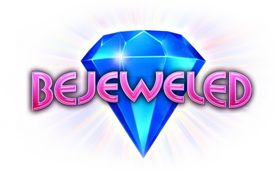

<div align="center">

# 💎 Bejeweled Web Clone

**Jogo de combinação de gemas desenvolvido com HTML, CSS e JavaScript puro**


-blue?style=flat-square)




</div>

---

## 📑 Índice

- [Sobre o projeto](#-sobre-o-projeto)
- [Autores](#-autores)
- [Como executar](#-como-executar)
- [Como jogar](#-como-jogar)
- [Funcionalidades](#-funcionalidades)
- [Estrutura do projeto](#-estrutura-do-projeto)
- [Tecnologias](#-tecnologias)

---

## 📖 Sobre o projeto

Implementação web do clássico jogo de combinação de peças **Bejeweled**, desenvolvida como projeto académico da unidade curricular **Introdução às Tecnologias Web (ITW)** da Licenciatura em Tecnologias de Informação (LTI).

O objetivo foi criar um jogo totalmente funcional usando apenas tecnologias web standard, integrando um website com regras, tutoriais em vídeo, definições e tabelas de pontuação.

| | |
|---|---|
| 📅 **Data** | Ano letivo 2022/2023 |
| 🏫 **Unidade curricular** | Introdução às Tecnologias Web (ITW) — LTI |
| 👥 **Grupo** | Nº 36 · Turma PL24 |
| 📄 **Relatório** | [Relatório_Projeto_ITW_Grupo36.pdf](Relatório/Relatório_Projeto_ITW_Grupo36.pdf) |

---

## 👥 Autores

| Nome | Número |
|------|:------:|
| **Pedro Rosa** ([@pedrorosa3](https://github.com/pedrorosa3)) | 60294 |
| **Tomás Nogueira** | 60285 |
| **Tiago Raposo** | 60293 |

---

## 🚀 Como executar

O projeto não precisa de instalação nem de dependências — basta um browser moderno (Chrome, Firefox, Edge…).

### 1. Obter o código

```bash
git clone https://github.com/pedrorosa3/Bejeweled.git
cd Bejeweled
```

> Em alternativa, descarrega o ZIP em **Code → Download ZIP** e extrai-o.

### 2. Abrir o jogo

**Opção A — Abrir diretamente**

Faz duplo clique no ficheiro **`Index.html`** e o site abre no browser.

**Opção B — Servidor local (recomendado)**

Alguns browsers limitam o carregamento de áudio/vídeo a partir de ficheiros locais. Para evitar isso, serve a pasta com um servidor local:

```bash
# Com Python 3
python -m http.server 8000
```

Depois abre <http://localhost:8000/Index.html> no browser.

**Opção C — VS Code**

Instala a extensão **Live Server**, clica com o botão direito em `Index.html` e escolhe **"Open with Live Server"**.

---

## 🎮 Como jogar

1. **Regista-te / Inicia sessão** — introduz os teus dados (email, palavra-passe, idade, género) para guardar as estatísticas.
2. **Começa o jogo** — vai a **Jogar**; o tabuleiro é preenchido com gemas aleatórias.
3. **Troca gemas** — seleciona duas gemas adjacentes (na horizontal ou vertical) para as trocar.
   > ⚠️ A troca só é válida se formar uma linha de **3 ou mais** gemas iguais.
4. **Ganha** — elimina **20 ou mais gemas** para completar o nível.

---

## ✨ Funcionalidades

### 🧩 Mecânica de jogo
- **Tabuleiro 8×8** com 7 tipos diferentes de gemas.
- **Trocas** entre gemas adjacentes para alinhar 3 ou mais iguais.
- **Queda das gemas** — as gemas eliminadas dão lugar às de cima, podendo gerar reações em cadeia.
- **Pontuação** calculada pela fórmula `(n − 3) + 1`, onde *n* é o número de gemas alinhadas.
- **Fim de nível** ao eliminar 20 ou mais gemas.

### 👤 Utilizadores e dados
- **Registo de utilizadores** obrigatório para jogar.
- **Persistência** dos dados e do histórico de jogos com **Local Storage**.
- **Tabela de classificação** com o Top 10 de pontuações e tempos.
- **Estatísticas** por utilizador: jogos realizados, tempo total e pontuação máxima.

### 🖥️ Interface
- **Design responsivo** que se adapta a diferentes tamanhos e orientações de ecrã.
- **HUD** em tempo real com tempo decorrido, pontuação e gemas restantes.
- **Música de fundo** e **vídeos tutoriais** (como jogar e comandos).

---

## 📁 Estrutura do projeto

```
Bejeweled/
├── Index.html            # Página inicial
├── Jogar.html            # Página do jogo
├── Comandos.html         # Explicação dos comandos
├── Informações.html      # Regras e informações
├── Definições.html       # Definições do jogo
├── Tabelas.html          # Classificações e estatísticas
├── Audio.html            # Página de áudio
├── Estilos/
│   └── style1.css        # Folha de estilos
├── Scripts/
│   └── comportamento.js  # Lógica do jogo e gestão de utilizadores
├── Imagens/              # Gemas, logótipos e fundos
├── Media/                # Música e vídeos tutoriais
└── Relatório/            # Relatório do projeto (PDF)
```

---

## 🛠️ Tecnologias

| Tecnologia | Utilização |
|------------|------------|
| **HTML5** | Estrutura e conteúdo das páginas |
| **CSS3** | Estilos e layout responsivo |
| **JavaScript** | Lógica do jogo, manipulação do DOM e gestão de estado |
| **Local Storage** | Persistência de utilizadores e pontuações |

---

<div align="center">

*Projeto desenvolvido para fins educativos, inspirado no clássico Bejeweled (PopCap Games, 2001).*

</div>
